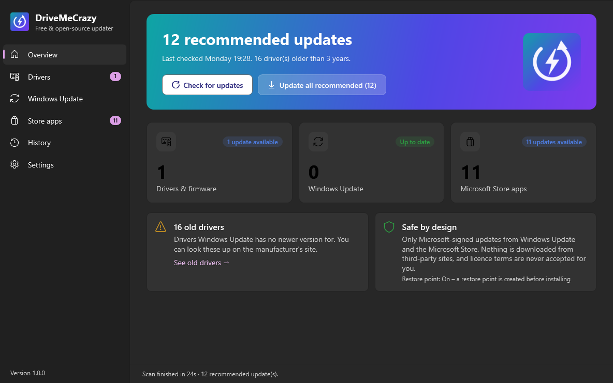
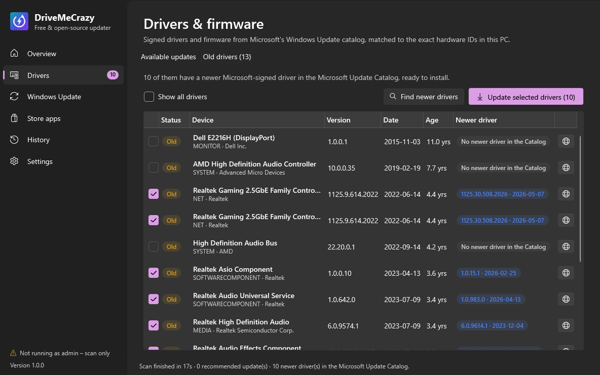

<p align="center">
  
</p>

<h1 align="center">DriveMeCrazy</h1>

<p align="center">
  <b>Free, open-source updater for Windows drivers, firmware, Windows updates and Microsoft Store apps.</b><br/>
  No ads. No tracking. No "PRO" upsell. Only official, Microsoft-signed updates.
</p>

<p align="center">
  <a href="../../releases/latest"><b>⬇ Download the latest release</b></a>
</p>



## Why another driver updater?

Most "driver booster" tools pull installers from their own mirrors, nag you to pay, and sometimes install the wrong driver.
DriveMeCrazy does the opposite:

- **Official sources only.** Drivers, firmware and Windows updates come from **Microsoft's Windows Update catalog**, the same
  signed packages that Settings → Windows Update → Optional updates offers. Store apps are updated through the
  **Microsoft Store** itself. Nothing is downloaded from third-party websites.
- **Matched to your hardware.** Every driver offer is matched to the exact hardware IDs in your PC, so you can see which device it is for.
- **Careful by default.**
  - Only the newest offer per device is pre-selected.
  - Drivers *older* than the one you already have are flagged and never pre-selected.
  - Updates with licence terms are never accepted for you.
  - A **System Restore point** is created before anything is installed.
- **You stay in control.** Nothing is installed until you click **Install**.

## Features

| | |
|---|---|
| 🧩 **Drivers & firmware** | Finds newer signed drivers/firmware for your devices on Windows Update and installs them one by one with live status. |
| 🕰️ **Old drivers → newer drivers** | Lists every driver older than N years (Windows' built-in drivers excluded) and looks each one up in the **Microsoft Update Catalog**, which has many more Microsoft-signed drivers than Windows Update offers automatically. Pick the ones you want and click **Update selected drivers**. |
| 🪟 **Windows Update** | Security, quality and optional Windows updates in the same list. |
| 🛍️ **Microsoft Store apps** | Checks and updates installed Store apps. |
| 🛟 **Safety net** | Automatic restore point (offers to turn System Protection on if it's off), install history, and logs. |
| 🌗 **Looks at home on Windows 11** | Fluent design, follows your light/dark theme. |



## Install & run

1. Download `DriveMeCrazy.exe` from the [latest release](../../releases/latest). It's a single file and needs no installer and no .NET.
2. Double-click it and accept the administrator prompt (installing drivers and Windows updates needs admin rights).
3. Click **Check for updates**, review the list, then **Update all recommended** or pick individual items.

> **"Windows protected your PC"?** The app isn't code-signed yet (certificates cost money), so SmartScreen shows a warning
> for new downloads. Click **More info → Run anyway**. You can check the SHA-256 published with each release, or build it yourself (below).

Requires Windows 10 version 2004 or later, or Windows 11, x64.

## FAQ

**Can it update *any* driver?** It can install any driver that hardware makers publish to Microsoft, through Windows Update or the
[Microsoft Update Catalog](https://www.catalog.update.microsoft.com). That covers most chipset, GPU, audio, network, Bluetooth and
camera drivers. A few vendors only publish some drivers on their own websites. For those, the 🌐 button in **Old drivers** searches the web for the manufacturer's page.

**How are Catalog drivers checked?** Before anything is installed, every package must pass all of these checks:

1. It's downloaded only from Microsoft's servers.
2. It has a valid Microsoft (WHQL) signature, verified with Windows' `WinVerifyTrust`.
3. It's strictly newer than your current driver.
4. Its INF lists your device's exact hardware ID for your CPU architecture.

It's then installed with Windows' own `pnputil`, and DriveMeCrazy re-reads the device's driver version to confirm the update really happened.

**Is it safe?** It uses the same Windows Update Agent API and Microsoft Store APIs that Windows itself uses, and it makes a
restore point first. If something goes wrong, open Device Manager → device → *Roll Back Driver*, or use System Restore.

**Does it collect data?** No. There's no telemetry. Logs and history stay on your PC in `%LocalAppData%\DriveMeCrazy`.
The Catalog search sends the hardware IDs of your old devices (e.g. `VEN_10EC&DEV_8125`) to Microsoft's catalog website. You can turn that off in Settings.

## Build from source

```powershell
# Requires the .NET 10 SDK
git clone https://github.com/themysticg/DriveMeCrazy.git
cd DriveMeCrazy
dotnet test
dotnet run --project src/DriveMeCrazy.App -p:DmcAsInvoker=true   # runs unelevated: scan only

# Single-file release build
dotnet publish src/DriveMeCrazy.App -c Release -r win-x64 --self-contained -p:PublishSingleFile=true -o publish
```

`DriveMeCrazy.exe --screenshot <folder> [--theme Light|Dark] [--no-scan]` renders every page to PNG and exits, which is useful for docs and smoke tests.

### Project layout

```
src/DriveMeCrazy.Core   Scanning, matching and installing (WMI, Windows Update Agent, Store APIs)
src/DriveMeCrazy.App    WPF app (.NET 10, Fluent theme, MVVM)
tests/                  xUnit tests for the matching rules
```

## Contributing

Issues and pull requests are welcome. See [CONTRIBUTING.md](CONTRIBUTING.md). Ideas on the roadmap:

- Desktop app updates via winget (Chrome, Discord, 7-Zip, …)
- Scheduled background checks with notifications
- Code signing for releases
- Translations

## License

[MIT](LICENSE). DriveMeCrazy is an independent project and is not affiliated with Microsoft or any hardware vendor.
